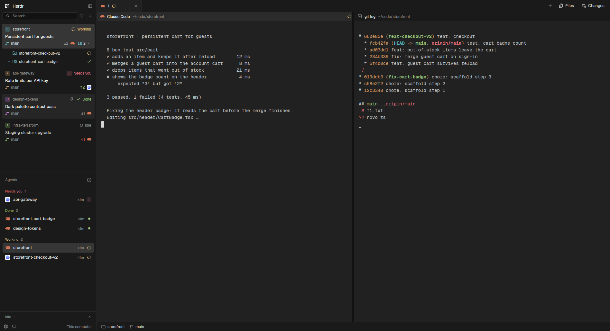

# Noctua

A flat, dark Herdr window in neutral graphite grays, no blue: a `#1a1a1a` sidebar with spaces as three-line cards and agents grouped by status, docked tabs where the active one runs into the terminal under it, and a slim header on every pane. Controls and selections have 4 px corners; panes stay square and flush.

## What you see

Left to right, at zoom 1, theme `noctua` (`themes/noctua.json`: background `#212121`, foreground `#c4c4c4`, canvas `#121212`, chrome `#1a1a1a`, popover `#1d1d1d`, raised `#2b2b2b`, hover `#262626`, selected `#363636`, border `#2a2a2a`, input `#383838`, muted `#d6d6d6`, dim `#8f8f8f`, accent `#e0e0e0`, working `#e5c07b`, blocked `#e06c75`, done `#98c379`, idle `#8f8f8f`; ANSI is One Dark with `ansi0` on the background). Every state is a step of gray: rest, hover `#262626`, selected `#363636` with white text; a toggle that is on (Files, Changes) takes the selected fill too. No system title bar. Terminal font: Geist Mono Noctua, Geist Mono with the text symbols it lacks (✔ ✖ ⚠ ☑ ⏸ and 83 more) drawn in one cell, so Claude Code's checked box reads `[✔]` in its green instead of a gray emoji over the `]`. UI font: the person's (Geist by default).

- **Sidebar**, 300 px, background chrome, 1 px border `#2a2a2a` divider on its right. Top to bottom:
  - **Brand**, 66 px, drags the window, in the same lines as the tab bar and the pane header beside it. Row 1, 38 px: the Herdr logo (16 px), "Herdr" 13.5 px semibold white, and the fold button (panel icon). Row 2, 28 px: a Search field (24 px tall, canvas fill, 1 px input border, magnifier, "Search"; the picker's key from `keys.json`, e.g. `Ctrl Shift K`, shows only in its tooltip), a filter button (list-filter icon) and a + for a new space, both 24 px. New agents start from the + on the tab bar. A 1 px border closes the block at the pane header's line.
  - **Spaces**, half of what is left, with no label row: the cards start 6 px under the brand. Each space is a card, 7 px by 10 px inside, 2 px apart:
    1. 20 px line: a 16 px monogram in ink (first letter, 9.5 px bold, centered both ways on a 16 px line height, in the space's color lightened 15% on that color at 24% alpha; the color is one of ansi6, ansi3, ansi5, ansi2, ansi1, kept per space; a space stored with ansi4 from before gets another), the folder name in dim (muted when shown), a pin when pinned, and the space's status at the right: blocked = a 16 px "!" square in red on a 20% red fill + "Needs you"; working = a turning ring + "Working" in yellow; done = a check + "Done" in green; idle = a ring + "Idle" in dim. No agents, no status.
    2. The shown tab's title, 13 px semibold white: the tab's name if someone named it, else the title its agent set (dim and weight 500 when the space is idle and not shown).
    3. 18 px line, 11.5 px dim: the branch icon in the space's color (the monogram's letter color) and the branch, ↑ahead in green, ↓behind in red, ±uncommitted in dim, then the icons of the programs of the space's agents (14 px, each once, up to 5), and, on a repo with worktree spaces, the worktree button at the end: 20 px tall, no fill or border, a 12 px folder-git icon in the space's color, the worktree count (11 px, medium, dim; muted when open) and a 10 px chevron (right closed, down open). Hover fills it with `input` and turns the text white.
    The shown space's card has the selected fill `#363636`; hover is `#262626`. A repo's worktree spaces are hidden until its button opens them: then they sit under its card on the list's own fill, tied to it by a 1 px guide in the space's color at 45% (18 px in, from the card down to the middle of the last line), each a 26 px line: an 8 px tick off the guide, the folder-git icon in the space's color, name, ↑↓±, and the status icon alone; the shown one has the selected fill. With another machine known, spaces sit under a 26 px machine header (monitor or server icon, name or "This computer", +, a green or dim square, a fold chevron).
  - **Agents**, the other half, 1 px border on top: Herdr's agents list with an Idle drawer. "Agents" label with a sort button (Priority or Grouped by space); in Priority, the list holds Pinned, Needs you, Done and Working, and Idle is a drawer fixed at the bottom, against the footer: a 1 px border on top, a 32 px head ("Idle", the count, a chevron up when closed and down when open), then its rows (at most 150 px, scrolling). Closed, it still shows the focused idle agent; open, all of them. Grouped by space keeps one section per space with its idle agents in it. Each row 30 px: the program's real icon, "space · task", time since its state changed, and its status (spinner, "!" square, a 7 px done square, a 7 px idle ring). Sub-agents nest under their parent with tree lines.
  - **Footer**, 44 px, border on top: Settings (with a 6 px accent square when an update is ready), Machines, and "This computer" in dim at the right.
- **Work column**, the rest:
  - **Tabs**, 38 px, chrome, drags the window. Tabs are docked: 140 px or wider, 12 px in on the left, a 1 px border between them. Each shows its program's icon, its name (or the program's name for an unnamed one), its status (a 14 px "!" square for blocked, a yellow spinner for working, a green check for done) and a × that shows on the active tab or under the pointer. The active tab takes the terminal's background `#212121` and the foreground color, with no line under it and no colored border, so it runs into the pane; every other tab and the empty bar keep a 1 px bottom border. At the right: + (the new-menu), Files and Changes (28 px; the open one gets the hover fill, a 1 px input border and white text), then minimize, maximize and close where the system draws no window buttons.
  - **Panes**, on the canvas `#121212`, 6 px apart, no padding around them, no border, radius 0, framed even when alone. Each has a 28 px header: program icon, name (font medium), folder in dim, status (spinner, a red "Needs you" badge, a green check). The focused pane's header is raised `#2b2b2b` with a white name; the others are chrome with a muted name. A 1 px border under the header. Terminal padding 14 by 12.
  - **Side panel**, hidden until Files or Changes opens it: 368 px (280 to 900), a stack of Herdr's `files` and `changes`.
  - **Status bar**, 24 px: Herdr's `workspace-status`.

## How it behaves

- Agent status: blocked shows in red everywhere (the space card says "Needs you", the tab and pane carry "!" or the badge, the agents list puts it in Needs you); working turns a yellow ring; done is a green check (a green square in the agents list); idle is a dim ring and the word "Idle" on the card. A space and a tab show their most urgent agent: blocked > done > working > idle.
- Brand: Search and the filter button open the space picker (`mod.open {name: "picker"}`); + runs `space.new`. The fold button turns the sidebar into a 44 px rail (76 on macOS) and back to the width it had.
- Rail (sidebar under 160 px), as in T3: only the brand block shows. Its 38 px row holds the Herdr logo, which turns into the panel icon under the pointer and opens the sidebar; its 28 px row holds Search. On macOS the traffic lights take the first row, so the open button and Search share the second. Spaces, agents and the footer draw only the chrome fill.
- Spaces: click a card or line to show the space, drag one onto another to move it, right-click for Herdr's space menu. Hover a card for its pin button: pinned cards stay on top, with their worktrees, and keep a pin. A repo's worktree button opens and closes its worktree lines without showing the space; the open repos are kept in the mod's `localStorage` (`worktrees.open`) across restarts, all closed at first. Click a machine header to fold it; its + makes a space there.
- Agents: click a row to focus its pane, hover for its pin, click a header to fold a group. Click the Idle head to open or close the drawer; the choice is kept in the mod's `localStorage` (`idle.open`), closed at first.
- Tabs: click to show, drag onto another tab to move it, double-click to rename, right-click for Herdr's tab menu, wheel over the bar for the next or previous tab, × to close. Files and Changes toggle the side panel; the choice is remembered per space.
- Panes: click the header to focus the pane; on hover, split right, split down, zoom (or unzoom) and close show at its right.
- Corners: every radius in the mods is 4 px (`const R = 4`). The pane frame radius comes from the layout file (0).

## Built from

- `layouts/noctua.json`. Root: `row`, `"titlebar": "none"`, `"traffic_lights": [12, 16]`, theme `noctua`, background `canvas`, `terminal_padding: [14, 12]`, 1 px border divider.
  - `sidebar` column, 300 px (44 to 480), chrome, not resizable: `brand` block (66 px, `window_drag`, mod `noctua-chrome`), `sidebar-lists` column with `spaces` (`noctua-spaces`) and `agents` (`noctua-agents`), weight 1 each, min 90; `sidebar-footer` block (44 px, `noctua-chrome` with props `{ "footer": true }`).
  - `work` column, not resizable: `tabs` block (38 px, `window_drag`, `noctua-tabs`); `work-body` row (padding 0, gap 6) with `main` (`{ "tab": "active" }`, pane frame: gap 6, radius 0 or 4, background `background`, `lone: true`, border width 0, header `noctua-pane` 28 px on top, always shown) and `panel` (hidden column, 368 px, stack `panel-body` of `files` and `changes`); `status` block (24 px, `workspace-status`).
- Mods, all `"place": "none"`, each started as a copy of Herdr's mod of the same role:
  - `noctua-chrome` (from `workspace-chrome`): brand and footer by `props().footer`. Holds the shared icons the other four use (`mods/noctua-chrome/*.svg`: lucide `search`, `list-filter`, `square-pen`, `sidebar`, `settings`, `monitor`, `server`, `plus`, `minus`, `square`, `x`, `check`, `circle`, `spinner`, `pin`, `pin-off`, `git-branch`, `folder-git-2`, `files`, `git-compare`, `terminal`, `chevron-*`, `clock`, `layers`). Calls `keys()`, `updates()`, `layout()`, `run("mod.open")`, `run("app.settings")`, `run("layout.resize")`, `openOverlay({ mod: "new-menu", kind: "popup" })`, `setShared("sidebar.width" | "sidebar.collapsed")`. Logo: `frame/welcome/herdr.png`.
  - `noctua-spaces` (from `spaces`): `spaces()`, `panes()`, `agents()`, `machines()`, `hc(["machine","ls","--json"])`, `exec("git", ["status","--porcelain=v2","--branch"], …)` and `git rev-parse` in each space's folder (on its machine), `watchFolder` on local repos' git folders, `run("space.select" | "space.move" | "space.new")`, the `menu` popup. It lists spaces as groups, a card and its repo's worktree spaces, so a closed group draws only the card. Shared keys: `space.colors` (the same as Herdr's spaces mod) and `noctua.spaces.pinned`; folded machines and open repos (by git common dir) in its `localStorage`.
  - `noctua-agents` (from `agents`): Herdr's list with Noctua's radii and icon paths, and the Idle section of the priority view moved into the drawer; its sort menu reopens itself as `noctua-agents`. Shared key `agents.sort`; pins, state times and the drawer's open state in its `localStorage`.
  - `noctua-tabs` (from `tabs`): `run("tab.select" | "tab.move" | "tab.rename" | "tab.close" | "tab.next" | "tab.prev")`, `layout.show/hide/select` on `panel` and `panel-body`, the `menu` and `new-menu` popups, shared `workspace.panels`; per-space panel choice in `localStorage`.
  - `noctua-pane` (from `pane`): `panes()`, `run("pane.focus" | "pane.split" | "pane.zoom" | "pane.close")`; its own split, zoom and close icons.
- Shipped mods it relies on: `picker`, `new-menu`, `menu`, `machine-add`, `files`, `changes`, `workspace-status`.
- In every mod white text is `ansi15` on a dark theme, `foreground` on a light one.
- `scripts/build-font.py [--check]` writes `mods/noctua-chrome/fonts/GeistMonoNoctua-{Regular,Bold,Italic,BoldItalic}.ttf` and `OFL.txt`: Geist Mono 1.9.0 from npm plus every text-default emoji from U+2000 to U+2BFF in Unicode 16's `emoji-data.txt` that it lacks, taken from the system's Noto Sans Symbols 2 (else Noto Sans Symbols), scaled into one 600-unit cell and centered on half the cap height. Both layouts set `"font": "Geist Mono Noctua"`; Herdr loads it from the mod's `fonts/` folder.
- `scripts/install.sh [--dry-run]` copies `layouts/`, `themes/` and `mods/` into `${HERDR_APP_HOME:-~/.config/herdr-app}`, replacing earlier `noctua*` copies whole and refusing any other name.

## Watch out

- The mods reference their icons as `mods/noctua-chrome/…` from the app's home: they show only once installed there, not from the repo.
- Herdr 0.1.9 draws any symbol its terminal font lacks with the color emoji font, two cells wide and gray whatever color the program asked for. Geist Mono Noctua is the workaround; a symbol outside its list still falls back that way.
- With Geist Mono Noctua, bold text is bold: Herdr drew Herdr's own Geist Mono without a bold face.
- The Search tooltip names whatever `keys.json` binds to `mod.open:picker` (`ctrl-shift-k` by default), not a fixed `Ctrl K`; with no binding it says only "Search".
- `themes/noctua.json` doesn't reload live: switching to the same layout keeps the old colors; switch to another layout and back (which closes floating windows) or restart. Measured on 30 October 2026: selected stayed `#3a4a5c` after install until `layout.switch main` then `noctua`.
- `herdr-app check` runs a mod with no spaces against the real `shared.json`: `noctua-spaces` skips its shared writes when it sees no spaces, or a check would wipe `space.colors`.
- Space pins are Noctua's own (`noctua.spaces.pinned`): Herdr's spaces mod doesn't know them.
- The active tab is "docked" by leaving its bottom border out while every other tab, the empty bar and the right group draw theirs; a single border on the bar would run under the active tab.
- `herdr-app check` renders with no spaces, agents or layout, so it doesn't reach the cards, tabs or headers with content; a check that matters feeds fixtures (see Done when). It also writes `gpui-kit.d.ts` and `jsconfig.json` into each mod folder; `.gitignore` keeps them out.
- The Changes button shows no count; the prototype's "3" isn't built.
- Worktree nesting and ↑↓± need `git` on the space's machine; a space outside a repo shows "no repo" on line 3.
- The worktree button selects nothing: it stops the mouse down and up itself, because the card shows its space on mouse up.
- `preview.png` is a demo: a separate core (`HC_SESSION=demo hc …`), a window with its own short `HERDR_APP_HOME` and `HERDR_RELEASES_URL` pointed at nothing (no update notice), git repos in `~/code`, and stand-in agents that only print `ESC ]7501;state=…:app=… ESC \`. A `done` status counts only when it arrives while another space is shown.

## Done when

- `herdr-app check <folder>` passes for each of `mods/noctua-chrome`, `noctua-spaces`, `noctua-agents`, `noctua-tabs`, `noctua-pane`.
- The same five, rendered with fixture data (spaces with blocked, working, done and idle agents, a pinned space, a remote machine, three tabs, a focused and an unfocused pane, the footer, the rail), pass `herdr-app check`, and `--print-spec` shows every `rounded` at 4.
- With fixtures of repos with 0, 2 and 5 worktrees (the shown one among the hidden) and agents in every state with an idle one focused, `--print-spec` shows: closed repos with no worktree lines; open repos with the guide and their lines; the Idle drawer as the agents view's last child, with only the focused agent closed and all four open; on the rail, spaces, agents and footer as one empty fill.
- `scripts/install.sh --dry-run` lists the layout, its preview, the theme and the 5 mods and writes nothing; with a non-`noctua` folder added under `mods/` it exits 1 before copying.
- After installing, `herdr-app do layout.switch --name noctua` shows the window with no `layout.error`, and `herdr-app status` lists no mod errors.
